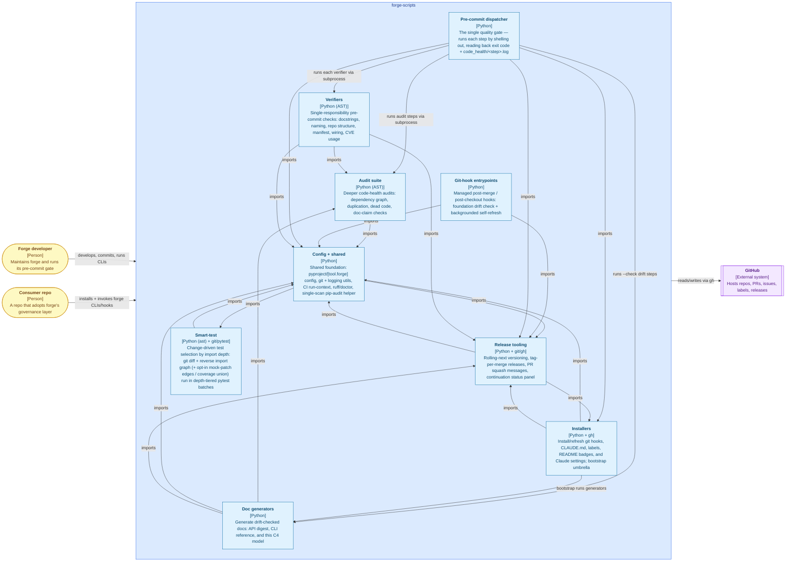

# Forge's architecture

Forge's own C4 component model, generated by `forge-gen-c4` from the
import graph and [`c4.toml`](../c4.toml): component dependencies are
derived from the code; context, containers and runtime edges are
declared by hand. The canonical model is
[`architecture.dsl`](architecture.dsl); `forge-gen-c4 --format html`
renders an offline view. How the generator works and why:
[C4 generator design](c4-architecture.md).

<!-- forge:c4:start -->
<!-- Generated by forge-gen-c4 — do not edit by hand; regenerate with `forge-gen-c4`. -->

<!-- forge:c4:end -->

## Agent fleet

The agents are actors too: the main agent a developer talks to runs
skills, follows FOUNDATION and delegates to specialist agents, which
drive the commands above. That graph is too dense for one picture, so
[Agent architecture](agent-architecture.md) slices it by workflow phase
(design and development, review, release, backlog, docs) plus a view of
the agents that enforce FOUNDATION.

## Harness compatibility (Claude Code, Mistral Vibe, future)

Forge's quality gate is the CLI, never the model — and never the harness.
The registration layer (guards, agents, skills, instructions) is the only
harness-shaped part. Today that layer is **Claude-shaped at the base, with
per-harness adapters on top**:

```
harness (Claude Code / Vibe / future)
        │  native payload + verdict format
        ▼
HarnessProfile (src/forge/agent_harness.py — pure data per harness:
event map, tool-matcher map, payload field renames, verdict emitter)
        │  translated payload (original stdin bytes re-fed) + deny/exit-2
        ▼
forge-hook-dispatch (roster sidecar = single runtime source, fail-closed)
        │  guard contract (JSON on stdin, exit 2 = block, stderr = reason)
        ▼
31 claude-hooks/*.sh guards  ←  the base layer, pinned by tests/test_claude_hooks.py
        ▼
deterministic CLIs (forge-precommit, forge-commit, …) — harness-agnostic core
```

Why the adapter sits on top of the Claude-shaped guards rather than the
reverse (FOUNDATION §7/§16, recorded in `agent_harness.py`'s docstring):
the guard contract — hook JSON on stdin, exit 2 to block — is pinned by
~9700 lines of contract tests and is the shipped-plugin interface, outside
our control. Rewriting the guards to a neutral protocol would regress that
pin to buy nothing today. The profile is data, so adding a harness is
adding a profile, never touching the guards.

**Target architecture (not yet built):** invert the dependency so a
harness-neutral **base contract** sits underneath and each harness is a thin
adapter above it. Concretely: define the neutral guard protocol once
(structured event record + verdict object, e.g. `forge.guard_contract`),
migrate the guards to consume it (the command-position scanner and payload
shapes already get re-fed original bytes, so the migration is mechanical per
guard), and reduce each `HarnessProfile` to pure translation between the
harness's native wire format and that contract. The dispatcher becomes a
thin router; profiles keep only event/matcher/payload/verdict maps. New
harnesses then cost one profile file plus a hooks.toml-equivalent generator
entry, and the guard suite gains one contract test suite instead of N
per-harness ones. The Vibe port in this branch is the proving ground for
that seam: everything harness-specific already lives in the profile +
generator, so the migration path is to move the contract *down*, not to
rewrite guards per harness.

Invariants that hold in both architectures: the harness is always named
explicitly (`--harness vibe`), never sniffed — a silent misdetection emits
the wrong verdict format, which reads as "allow"; every dispatcher failure
path denies; guard stdout is never forwarded (stdout carries exactly one
verdict JSON); and events a harness cannot express are reported as
unenforced, never silently dropped (`UNENFORCED_VIBE_HOOKS` is
single-sourced in `agent_harness.py` and printed by `install-forge-vibe`).
See [docs/vibe.md](vibe.md) for the Vibe-specific behavior.
